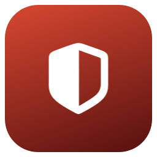
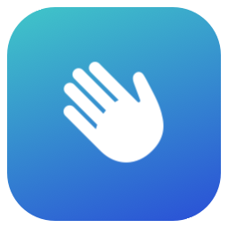
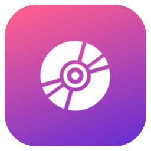

# Desklet widgets

Katalog widgetów dla [Desklet](https://github.com/zacard89/Desklet). Desklet pobiera to repo kluczem tylko do odczytu
(deploy key) i pokazuje widgety w oknie ✨ → **Widgety…** (sekcja **Katalog**), skąd instaluje się je jednym kliknięciem.

## Widgety

| | Widget | Opis | Konfiguracja |
|---|---|---|---|
|  | [`dota`](dota/) | Dota 2: 8 ostatnich meczów z bohaterami (wersje arkana/persona, Invoker jako Kid), ostatni mecz z KDA, bilans dziś / 7 dni / ostatnie 20 / łącznie, seria i najczęściej grany bohater. Dane z OpenDota, bez uruchamiania procesów. | **Konto Dota** – ID OpenDota, SteamID64 albo link do profilu Steam / OpenDota; **Odświeżanie** – 5, 10 lub 30 min |
|  | [`hello`](hello/) | Widget testowy: powitanie zależne od pory dnia i zegar z sekundami. Przykład pola konfiguracji. | **Imię** – pokazywane w powitaniu |
|  | [`nowplaying`](nowplaying/) | Okładka utworu z Apple Music kręcąca się jak płyta, z tytułem, wykonawcą i paskiem postępu; znika, gdy nic nie gra. Bez przycisków. Wymaga Desklet z obsługą Apple Music (`nowPlaying()`) i jednorazowej zgody macOS na sterowanie Muzyką. | brak |

## Format

Każdy widget to katalog:

```
nazwa-widgetu/
├── index.coffee      # albo index.js / nazwa-widgetu.coffee
├── widget.json       # {"description": "krótki opis do katalogu"}
├── icon.png          # ikonka 256×256 pokazywana w oknie Widgety i w tym README
├── lib/ assets/      # dowolne pliki widgetu; w kodzie: run("python3 lib/x.py"), asset("assets/x.png")
```

Ustawienia, które użytkownik ma wpisać sam (np. konto), deklaruj jako opcje z `type: 'text'` albo `'number'` –
Desklet pokaże je w oknie **Widgety…** po kliknięciu **Konfiguruj**, a wartość trafi do pola widgetu o tej samej nazwie:

```coffee
options:
  name:
    label: 'Imię'
    type: 'text'
    default: ''
    help: 'Pokazywane w powitaniu.'
```

Nie wpisuj w kodzie danych konkretnej osoby (konta, tokeny) – domyślna wartość powinna być pusta, a widget powinien
w takim wypadku poprosić o konfigurację.

Zmiana katalogu widgetu w repo pojawia się w Desklet jako **Aktualizuj**. Dodając widget, dopisz go do tabeli wyżej.
